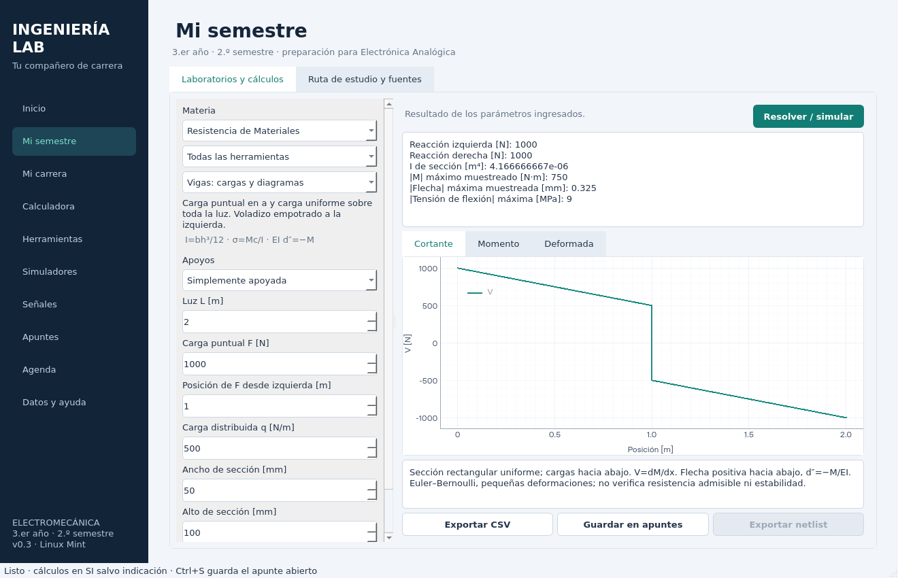

# Ingeniería Lab 0.3 · Mi semestre

Compañero de estudio **local, en español y preparado para Linux Mint Cinnamon**, para Ingeniería Electromecánica con orientación electrónica. Esta versión se enfoca en tu **segundo semestre del tercer año** y en la preparación de **Electrónica Analógica**.



## Novedades: 30 herramientas para tus materias

| Materia | Herramientas nuevas |
|---|---|
| **Resistencia de Materiales** | Vigas apoyadas/voladizo con carga puntual y distribuida; diagramas de cortante, momento y flecha; Mohr y Von Mises; torsión; pandeo Euler. |
| **Cálculo Numérico** | Bisección/Newton/secante con iteraciones; trapecios y Simpson; interpolación y regresión; Euler y RK4 comparados con una referencia adaptativa. |
| **Instalaciones Eléctricas** | Caída mono/trifásica con temperatura y material; sección por caída; compensación reactiva; corriente de diseño y desigualdad Ib≤In≤Iz; cortocircuito con Z conocida. |
| **Mediciones Eléctricas y Electrónicas** | Exactitud del multímetro; carga del voltímetro; propagación con correlación; galga y Wheatstone; muestreo y aliasing. |
| **Termodinámica** | Propiedades de agua/R134a con CoolProp; Rankine con propiedades reales; Otto; proceso politrópico; primera ley. |
| **Electrónica Analógica — preparación** | Rectificación y rizado; BJT y pequeña señal; operacional con recorte; Bode RC; Shockley; Zener; RC y emisor común DC/AC con **ngspice real**. |

Cada herramienta incluye unidades, fórmulas, datos editables y límites del modelo. Los resultados pueden guardarse como apuntes con sus parámetros; curvas y tablas se exportan a CSV. Los dos laboratorios SPICE también exportan su netlist.

Se mantienen las funciones de la versión 0.2: las 39 materias (sin religión ni ética), 16 calculadoras generales, conversor de unidades, calculadora simbólica, matrices, estadística, cinco simuladores generales, generador de señales/FFT, apuntes, agenda y respaldos.

**Investigación y fuentes:** [informe completo](docs/INVESTIGACION-v0.3.md). Se compararon Qucs-S, ngspice, CircuitJS, KiCad, Octave, SciPy, SymPy y CoolProp mediante documentación primaria. El informe explica qué se incorporó, qué se implementó de forma propia y qué queda fuera del alcance.

## Instalación en Linux Mint Cinnamon

Recomendado: **Linux Mint 22.x y Python 3.12**. Se admite Python 3.11–3.14 con dependencias compatibles. Necesitás Internet para instalar; después los cálculos, ngspice y los apuntes funcionan localmente.

1. Descargá el ZIP de la **rama de la versión 0.3** desde GitHub: **Code → Download ZIP**.
2. Descomprimilo y abrí una terminal dentro de la carpeta que contiene `main.py`.
3. Ejecutá:

```bash
bash instalar_linux_mint.sh --sistema
bash iniciar_linux.sh
```

`--sistema` usa `sudo apt-get` para instalar Python/venv, bibliotecas Qt y **ngspice** desde los repositorios de tu sistema. La contraseña se introduce exclusivamente en tu terminal. Las bibliotecas de Python se instalan en `.venv`, sin `sudo pip`.

El instalador también crea **Ingeniería Lab** en el menú de aplicaciones de Cinnamon. No muevas la carpeta después de crear el acceso; si la movés, repetí la instalación para actualizarlo.

Si ya tenés las dependencias de sistema:

```bash
bash instalar_linux_mint.sh
```

### Si usás Mint 21

Su Python predeterminado suele ser 3.10, que no alcanza. Necesitás un intérprete compatible instalado por separado; no reemplaces el Python del sistema. Con Python 3.12 ya disponible:

```bash
PYTHON_BIN=python3.12 bash instalar_linux_mint.sh
```

El instalador detecta la versión y detiene la instalación con una explicación si no hay un Python compatible. No modifica repositorios APT ni instala versiones de Python desde fuentes externas.

### Instalación manual / desarrollo

```bash
python3 -m venv .venv
.venv/bin/python -m pip install -e '.[dev]'
sudo apt install ngspice
.venv/bin/python main.py
```

Ngspice es opcional para las otras 28 herramientas nuevas. Si falta, los dos laboratorios SPICE indican expresamente **“simulación NO ejecutada”** y permiten exportar el circuito. Se localiza en `PATH`, o mediante `INGENIERIA_LAB_NGSPICE=/ruta/al/binario`.

Para diagnosticar un error de plataforma Qt: `QT_DEBUG_PLUGINS=1 bash iniciar_linux.sh`. El modo `offscreen` es para pruebas, no para mostrar la ventana. Los lanzadores de Windows se conservan por compatibilidad, pero el flujo principal es Linux Mint.

## Uso inicial

- La aplicación abre **Mi semestre**. Elegí materia y herramienta, modificá entradas y presioná **Resolver / simular**.
- Revisá las pestañas de gráficos y, cuando corresponda, la **Tabla de cálculo**.
- Leé **Hipótesis y límites** bajo los resultados; el cuadro tiene desplazamiento para textos largos.
- **Guardar en apuntes** conserva datos, modelo y resultados sin reemplazar tus otros apuntes.
- **Exportar CSV** guarda la pestaña de resultados visible. Al cambiar entradas, se invalidan los resultados anteriores y hay que recalcular.
- En **Ruta de estudio y fuentes** hay una secuencia para el semestre y para empezar electrónica analógica.

Ejemplos reproducibles: [Prácticas del semestre](docs/PRACTICAS-v0.3.md). Guía de herramientas generales: [Guía v0.2](docs/GUIA.md).

## Tus datos se conservan

La base SQLite y el formato de respaldo de v0.2 permanecen compatibles. Los datos no se guardan en la carpeta del código y no se suben a GitHub.

- Linux: `${XDG_DATA_HOME:-~/.local/share}/ingenieria-lab/estudio.sqlite3`.
- Windows: `%LOCALAPPDATA%\IngenieriaLab\estudio.sqlite3`.
- Ruta personalizada: `INGENIERIA_LAB_DATA_DIR`.

Antes de actualizar, podés crear un respaldo en **Datos y ayuda**. Descomprimir otra versión no elimina tu base. Si cambiaste la ruta de datos por variable de entorno, usá la misma al abrir la nueva versión. No hay sincronización en nube ni guardado automático del editor: usá **Guardar apunte** o **Ctrl+S**.

## Verificación

```bash
.venv/bin/python -m pytest -q
```

Las pruebas de interfaz usan Qt `offscreen`. Los tests de integración del motor SPICE requieren ngspice y se omiten de forma explícita si falta. En la validación de esta entrega **ngspice sí estuvo disponible**.

Se verificaron cálculos con soluciones cerradas, balances físicos, conservación de energía, métodos numéricos, ngspice real, exportaciones, creación de notas, invalidación de resultados e interacción Qt. El instalador local, el acceso directo y el paquete Python también se validaron en Linux. **El entorno de pruebas es Debian 13 con Python 3.12; no se ejecutó una sesión nativa de Mint/Cinnamon ni la instalación APT de Mint.** Las versiones de dependencias usadas se registran en `requirements-linux-tested.txt`.

## Alcance científico

Las herramientas resuelven los casos identificados, no todos los problemas de cada asignatura. La selección de sección por caída **no es una selección normativa completa**: no verifica ampacidad, protecciones, puesta a tierra, desconexión o cortocircuito térmico. Los modelos mecánicos usan elasticidad lineal; el BJT simplificado usa VBE/β constantes y el operacional un recorte estático. El motor SPICE usa un NPN genérico. El informe y cada herramienta detallan las hipótesis.

La implementación es modular: `semester/` contiene los nuevos modelos; `ui/semester.py`, la interfaz; `core/` y `signals/`, las herramientas previas; `storage/`, la persistencia. `AGENTS.md` guarda tu preferencia por Linux Mint y las materias prioritarias para futuras mejoras.
