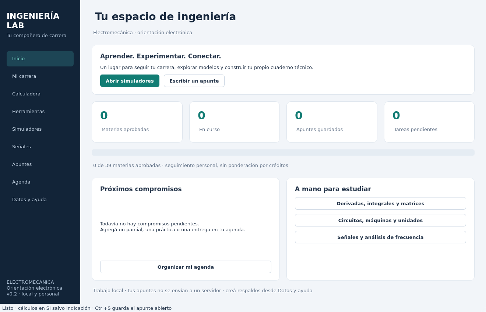

# Ingeniería Lab 0.2

Un compañero de estudio **de escritorio, en español y con datos locales** para Ingeniería Electromecánica con orientación electrónica. Amplía el laboratorio de señales de la versión 0.1 enviada como ZIP.



## Qué podés hacer

- **Mi carrera:** 39 materias de las imágenes, sin religión ni ética; buscar por nombre o tema, filtrar por área y marcar Pendiente / Cursando / Aprobada. Los ocho bloques reflejan las capturas, no semestres ni correlatividades oficiales. Los temas sugeridos deben contrastarse con la cátedra.
- **Calculadora:** evaluación real y compleja, derivadas, primitivas, integración numérica, raíces por Brent y gráficos de una variable. Matrices hasta 8×8 (Ax=b, determinante, autovalores y condición). Estadística descriptiva muestral.
- **16 herramientas:** Ohm, divisor de tensión, resistencias, operacional ideal, filtro RC, potencia trifásica, motor de inducción, sensor 4–20 mA, ADC, esfuerzo axial, flexión de una viga, bomba, continuidad, calor, Carnot e incertidumbre combinada.
- **Unidades:** longitud, área, presión, energía, potencia, temperatura, ángulo, frecuencia, capacitancia, inductancia y caudal.
- **Simuladores:** carga RC, escalón RLC, circuito RLC en CA, masa–resorte–amortiguador y control de segundo orden. Parámetros editables, gráficos y exportación CSV.
- **Señales:** seno, cuadrada, triangular y sierra; amplitud, fase, offset y muestreo; RMS, media, extremos, pico a pico, espectro FFT y CSV.
- **Apuntes:** texto por materia, búsqueda, edición, guardado con Ctrl+S, protección ante cambios sin guardar y exportación Markdown.
- **Agenda:** compromisos por materia y fecha; vencidos, pendientes, completados y reapertura.
- **Respaldo:** exportación JSON y restauración validada y atómica; copia automática de los datos previos al restaurar.

## Instalar en Windows

Necesitás **Python de 64 bits**. Recomendado: Python 3.12 o 3.13. Se admite 3.11–3.14 cuando las dependencias ofrecen versiones compatibles.

1. Descomprimí el ZIP completo en una carpeta con permiso de escritura.
2. Ejecutá `instalar_windows.bat`. La primera instalación requiere Internet para descargar las bibliotecas.
3. Ejecutá `iniciar_windows.bat`. En adelante funciona sin conexión.

Alternativa en PowerShell, dentro de la carpeta:

```powershell
py -3.12 -m venv .venv
.\.venv\Scripts\python.exe -m pip install -e ".[dev]"
.\.venv\Scripts\python.exe main.py
```

El ZIP contiene **código fuente y lanzadores**, no un ejecutable `.exe` autónomo. El lanzador usa el Python predeterminado de `py -3`; si tenés varias versiones o una versión no compatible, utilizá los comandos explícitos de arriba.

## Instalar en Linux

Con Python, venv y las bibliotecas de escritorio Qt/OpenGL del sistema disponibles:

```bash
python3 -m venv .venv
.venv/bin/python -m pip install -e '.[dev]'
.venv/bin/python main.py
```

También podés usar `bash iniciar_linux.sh` después de instalar. En una sesión gráfica se requiere un backend Qt funcional (X11 o Wayland). Si Qt informa dependencias ausentes, revisá su diagnóstico con `QT_DEBUG_PLUGINS=1`; las bibliotecas de sistema dependen de la distribución. El modo `offscreen` permite pruebas automatizadas, pero no muestra una ventana interactiva.

## Dónde quedan tus datos

- Windows: `%LOCALAPPDATA%\IngenieriaLab\estudio.sqlite3`.
- Linux: `${XDG_DATA_HOME:-~/.local/share}/ingenieria-lab/estudio.sqlite3`.
- Personalizable mediante `INGENIERIA_LAB_DATA_DIR` (ruta a una carpeta).

No se guardan dentro del código ni se transmiten a servidores. **No hay sincronización automática.** Usá Datos y ayuda → Crear respaldo JSON y conservá una copia en otra unidad. Los apuntes se guardan con el botón o Ctrl+S; al cambiar de apunte o cerrar, el programa pregunta por cambios pendientes. Los filtros y la navegación no borran el borrador abierto.

## Primera sesión sugerida

1. Marcá tus materias actuales como **Cursando**.
2. Agregá un parcial o entrega en **Agenda**.
3. Probá `sin(x) + x^2` en **Calculadora** → Derivada o Graficar.
4. Abrí **Simuladores** → RC. Aumentá C y compará la constante de tiempo.
5. Creá un apunte de la materia con hipótesis, unidades, resultado y dudas.
6. Exportá un respaldo.

Más ejemplos y modelos: [Guía de uso](docs/GUIA.md).

## Validación y desarrollo

```bash
.venv/bin/python -m pytest -q
```

Las pruebas de interfaz usan Qt `offscreen` automáticamente. Cubren cálculos de referencia, restricciones físicas, modelos analíticos, expresiones inválidas, persistencia, restauración, navegación y edición de apuntes. La versión se verificó con Python 3.12 en Linux; **no se ejecutó en Windows**. `requirements-linux-tested.txt` registra las versiones usadas, sin imponerlas a otros sistemas.

Estructura:

- `core/`: modelos, cálculos y simuladores independientes de la interfaz.
- `signals/`: generador y mediciones de la versión original.
- `storage/`: SQLite, respaldo y exportaciones.
- `ui/`: ventana y módulos Qt.
- `catalog.py`: materias y orientaciones de estudio.

## Alcance

Es una base extensible de estudio, no una implementación completa de cada asignatura. La matemática actual es de una variable; no incluye cálculo multivariable general. Los simuladores son modelos ideales, sin editor de circuitos SPICE, CAD, PLC físico ni selección normativa de protecciones. Los operacionales no modelan saturación; los modelos mecánicos son lineales. Cada herramienta especifica unidades y supuestos. Para interpretar una práctica, contrastá esos supuestos con los del ejercicio y la cátedra.
